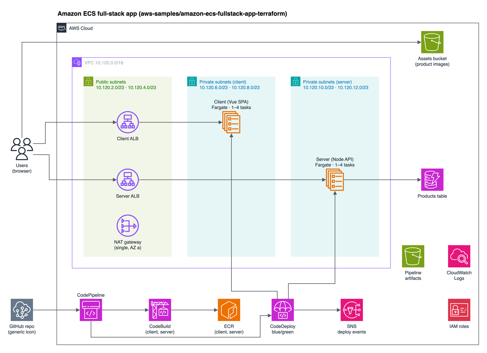
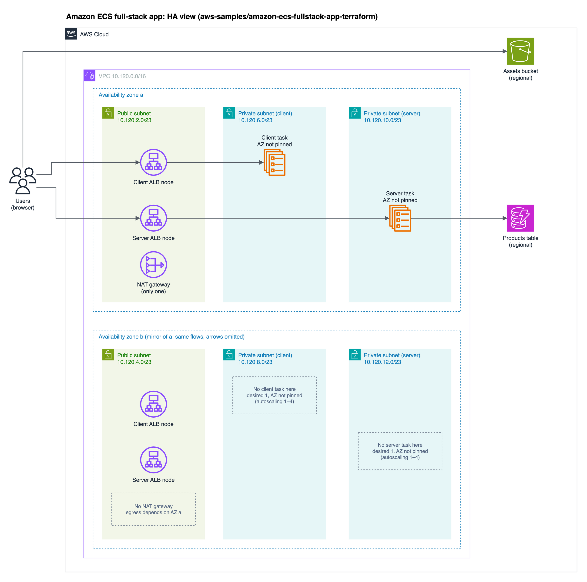

# aws-diagram

一個 [Agent Skill](https://agentskills.io)：從需求、repo 或 Terraform 產出**可編輯**的 AWS 架構圖。

產出是單頁 `.drawio`，用 AWS 官方圖示。你可以在 draw.io 裡手動調整版面，skill 會保留你的修改，再匯出 PNG / PDF / SVG。

## 特色

- **三種 preset**：`connectivity` 只畫服務和呼叫；`network` 加上 VPC、subnet、CIDR；`ha` 再加上 AZ、HA 角色和單點瓶頸。
- **有證據才畫**：每條箭頭都要對應到 IaC 或程式碼。security group 規則和 IAM 權限不算呼叫。證據寫在旁邊的 `<name>.architecture.json`。
- **不碰 AWS**：只做靜態閱讀，不跑 `terraform plan`，不呼叫 AWS API。
- **可以來回修改**：產圖後你在 draw.io 裡調整並存檔。之後的修改只 patch 受影響的 cell，不重畫整頁。
- **自動檢查**：`scripts/drawio_check.py` 檢查結構，並找出穿過圖示或標籤的線、重疊的線和交叉數。

## Demo

範例來源是 AWS 官方的 [aws-samples/amazon-ecs-fullstack-app-terraform](https://github.com/aws-samples/amazon-ecs-fullstack-app-terraform)（MIT-0），讀取的 commit 是 `98ee8e6`。

### `network` preset

前端（Vue）和 API（Node）各自跑在 ECS Fargate 上，前面各有一個 ALB。下方是 CodePipeline 的 blue/green 部署流程。



### `ha` preset

同一個 repo，換成 HA 視角。ALB 在兩個 AZ 都有節點。NAT gateway 只有 AZ a 一台。兩個 ECS service 起始都只有 1 個 task，AZ 沒有固定。虛線框標出 AZ b 缺少的東西。



每張圖的檔案都在 [`examples/ecs-fullstack/`](examples/ecs-fullstack/)：

| 檔案                              | 用途                                            |
| --------------------------------- | ----------------------------------------------- |
| `*.drawio`                        | 可編輯的原始檔                                  |
| `*.drawio.png` / `*.drawio.svg`   | 匯出圖，內嵌 diagram XML，可直接用 draw.io 打開 |
| `*.layout.py`                     | 產生 `.drawio` 的版面腳本                       |
| `ecs-fullstack.architecture.json` | 資源、關係、來源檔案和 HA 限制的證據紀錄        |

## 前置需求

- **[draw.io desktop](https://github.com/jgraph/drawio-desktop)**，需要 `drawio` CLI（macOS：`brew install --cask drawio`）
- **[uv](https://docs.astral.sh/uv/)**，用來執行 `scripts/` 裡的 Python
- **[Claude Code](https://docs.claude.com/en/docs/claude-code)** 或 **[Codex](https://developers.openai.com/codex)**

## 安裝

```bash
git clone https://github.com/tttingzhang999/aws-diagram.git
cd aws-diagram
./install.sh
```

腳本把 skill symlink 到 `~/.claude/skills/aws-diagram` 和 `~/.codex/skills/aws-diagram`，只連結已安裝的 agent。

## 使用

在 Claude Code 或 Codex 裡：

```text
/aws-diagram 幫我畫 ./infra 的架構圖
/aws-diagram draw the HA view of this Terraform repo
```

Skill 先問最多 3 個問題（preset、選配細節、輸出格式），再產圖給你預覽。你在 draw.io 調整完後回覆，它會接著修改或匯出。

重跑範例：

```bash
uv run examples/ecs-fullstack/ecs-fullstack.layout.py
uv run scripts/drawio_check.py examples/ecs-fullstack/ecs-fullstack.drawio
drawio -x -f png -e --scale 2 --border 20 -o examples/ecs-fullstack/ecs-fullstack.drawio.png examples/ecs-fullstack/ecs-fullstack.drawio
```

## 結構

```text
SKILL.md                      # 流程：訪談 → 產圖與調整 → 交付
references/drawio.md          # draw.io XML 結構與連線規則
references/style.md           # 群組樣式、間距、HA 版面規則
references/aws-icons.json     # 已驗證的 AWS4 stencil 與顏色
references/terraform-mapping.md
scripts/drawio_check.py       # 結構與走線檢查
scripts/layout_metrics.py
scripts/export_drawio.py      # 沒有 draw.io desktop 時的備用匯出
examples/ecs-fullstack/
```

## License

[MIT](LICENSE)。範例的架構來自 aws-samples，採 MIT-0 授權。
